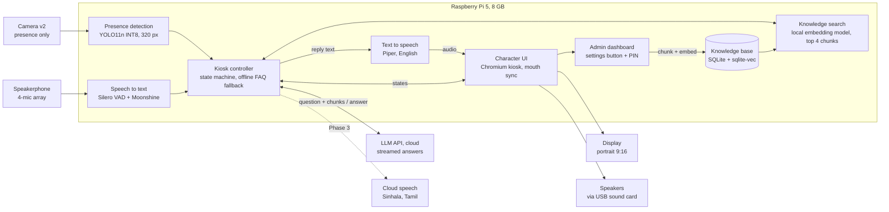
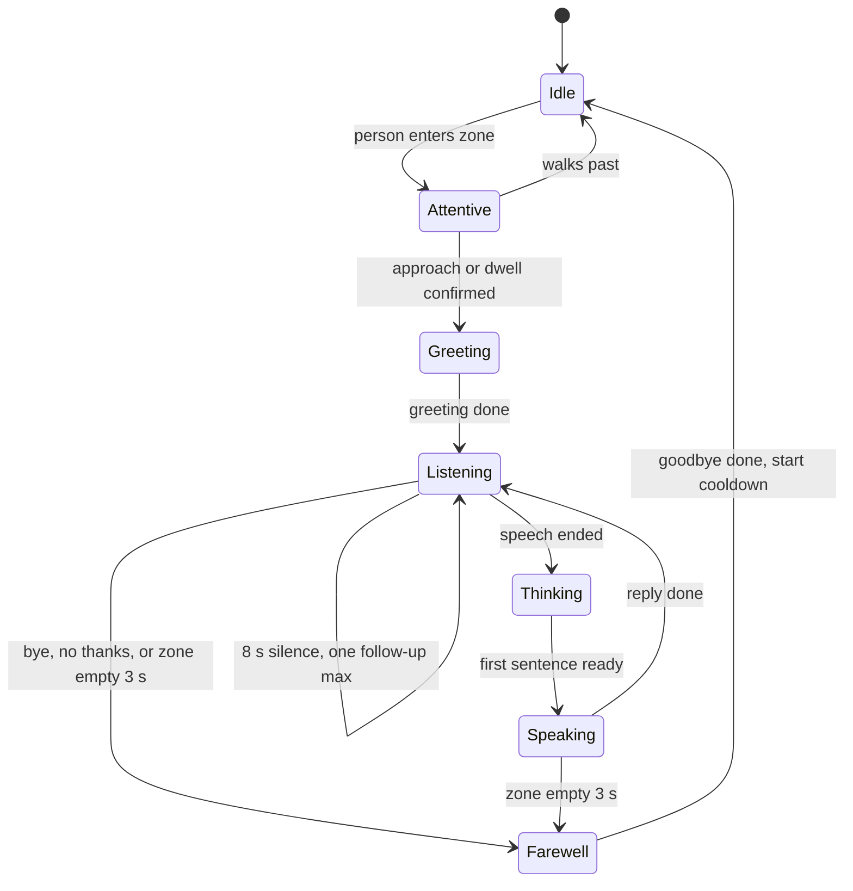

# IIT Visitor Kiosk: MVP Spec, BOM and Delivery Plan

- **Owner:** Daham (technical development and IoT)
- **Spec date:** 14 Oct 2026
- **Delivery and venue setup:** 21 Oct 2026
- **Exhibition:** 22 Oct 2026
- **Requirements source:** "Smart Visitor Engagement" spec from IIT / LeapGen

This file is the single source of truth for the build. If code and this file disagree, raise it; don't silently follow either.

---

## 1. Summary

We deliver an English-only visitor kiosk on **21 Oct 2026**, one day before the exhibition. It runs on a Raspberry Pi 5 (8 GB, no AI HAT) with a Pi Camera Module v2, driving a portrait (9:16) display over HDMI.

- An animated assistant character greets people who approach, answers spoken questions about IIT and LeapGen, and releases visitors politely.
- Answers come from a knowledge base of IIT content stored and searched on the Pi (RAG), so the assistant sticks to approved facts.
- Staff open a PIN-protected dashboard from a settings button on the kiosk to see usage stats, change settings and add content to the knowledge base.
- The camera detects presence only. No faces are identified, nothing is recorded.
- Speech, vision, knowledge search, embeddings and the UI run on the Pi. Only the language model is called over the internet.
- Sinhala and Tamil follow in two later phases, after the exhibition.

---

## 2. Scope and language roadmap

| Phase | Target date | Languages | What ships | Gate to release |
| --- | --- | --- | --- | --- |
| 1. MVP | 21 Oct 2026 | English | Presence detection, greeting, spoken Q&A from the knowledge base, admin dashboard, touch fallback menu, idle mode with music ducking | All MVP acceptance tests pass on site |
| 2. Multilingual greetings | About 6 Nov 2026 | English, Sinhala, Tamil | On-screen language choice, Sinhala and Tamil greetings and fixed phrases (pre-synthesised, cached on the Pi), translated idle messages, child mode copy | Fluent speakers sign off wording and pronunciation |
| 3. Full multilingual conversation | Mid Dec 2026 | English, Sinhala, Tamil | Spoken Q&A in Sinhala and Tamil through cloud speech services (si-LK, ta-LK); multilingual embedding model evaluated and adopted | Tested with native speakers in a noisy room; reply starts within 2.5 s |

**Deferred for the MVP:** acceptance test 7 of the original spec (English, Sinhala and Tamil greetings) moves to Phase 2. IIT must confirm in writing.

**Out of scope for all phases:** facial recognition, emotion recognition, age or language guessing from appearance, storing images, video or audio.

---

## 3. System architecture

Everything except the language model runs on the Pi, so the kiosk keeps greeting and answering FAQs even if the internet drops.



**Where RAG sits:** between speech to text and the LLM. Every question is embedded on the Pi and matched against the knowledge base. Only the top 4 chunks go to the LLM with the question. If nothing passes the match threshold, the assistant says it doesn't have that information and offers the touch menu instead of guessing.

**Content path:** content enters through the admin dashboard, where it is chunked and embedded on the Pi with the same model. No document leaves the Pi except the few chunks sent with each question.

**UI path:** the controller drives the character over a local WebSocket. Speech audio is streamed to the browser and played with Web Audio, so the mouth moves with the real loudness of whatever voice is speaking.

---

## 4. Functional spec (MVP)

Every timing and distance below is a config value (see section 9), tuned at the venue on 21 Oct.

### 4.1 Engagement state machine

| State | Enters when | What the assistant does | Leaves when |
| --- | --- | --- | --- |
| Idle | Boot, or after a visitor leaves | Breathing and blinking character, rotating IIT and LeapGen messages, startup journey animation, soft music | A person enters the zone |
| Attentive | Person in zone | Eyes follow the person, music drops to 35% | Approach confirmed (Greeting) or person walks past (back to Idle, silently) |
| Greeting | Person approaching or lingering about 1.5 s | Waves and says the greeting once per encounter (group greeting if 2+ people) | Greeting finishes |
| Listening | Greeting or reply finished | Mic open, ring animation, music muted | Speech ends (Thinking), or 8 s silence (one gentle follow-up, then wait) |
| Thinking | Speech captured | Thinking dots, head tilt | First reply sentence is ready |
| Speaking | Reply audio playing | Mouth moves with the audio, mic muted to avoid echo | Reply ends (back to Listening) |
| Farewell | Visitor says bye or no thanks, or zone empty for 3 s | Short polite goodbye; never calls after someone walking away | Back to Idle; 20 s cooldown before greeting someone new |



Rules from the requirements:
- Never repeat the greeting during the same encounter.
- If another visitor arrives mid-conversation, don't interrupt the current one.
- Reset the session (conversation history, UI state) before the next visitor.
- Silence is never consent to record, keep questioning or collect information.

### 4.2 Camera presence

- Person detection with YOLO11n (INT8) at 320 px input. Target 8 fps while idle.
- **Throttle while engaged:** once a visitor is in Greeting, Listening, Thinking or Speaking, drop detection to about 2 fps. We only need to know if they left, and this frees a CPU core for speech when latency matters most.
- Approach = the tracked person's box grows over about 1.5 s while staying near the centre. Passers-by crossing the frame are not greeted.
- The box centre steers the character's eyes (`lookAt`). No face recognition, expression reading or age estimation.
- Frames live in memory only and are discarded.
- Camera failure: the screen shows "Tap to talk"; touch and voice keep working.

### 4.3 Voice (English)

- Voice activity detection on the Pi, then speech to text on the Pi (Moonshine Small Streaming, English).
- The question is matched against the knowledge base on the Pi (section 5). The best 4 chunks and the question go to a cloud LLM, streamed sentence by sentence. The prompt limits it to answering from those chunks, in 2 or 3 spoken sentences.
- If no chunk passes the match threshold, the assistant says it doesn't have that information and offers the touch menu.
- Each finished sentence goes to Piper immediately, so the mouth starts moving within about 2 s of the visitor finishing.
- Half-duplex: the mic is muted while the assistant speaks.
- The assistant never asks for names, phone numbers or other personal details, and never asks children for personal information.

**LLM system prompt rules (to implement):**
1. Answer only from the provided context chunks. If they don't contain the answer, say so briefly.
2. Spoken style: 2 or 3 short sentences, no lists, no markdown, no URLs read aloud.
3. Warm, respectful, professional tone. Kids mode: simple words, encouraging, celebrate effort, never promise success.
4. Never ask for or repeat personal information.
5. Stay on IIT, LeapGen, programmes, campus, research, startups and events.

### 4.4 Idle mode and audio

- Licensed or royalty-free music supplied by IIT, at a low set volume. It ducks to 35% on approach, mutes while listening or speaking, and fades back in over 2.5 s.
- Music runs on its own audio path so it never drives the mouth.
- Rotating idle messages about IIT, programmes, research and LeapGen; occasional "Idea → Validate → Build → Launch" animation; prompt "Come closer and say Hello!".
- A settings button on the kiosk screen opens the PIN-protected admin dashboard (section 5). Volume, quiet mode, music mute and detection-zone calibration live there.

### 4.5 Fallbacks and reliability

- No internet, LLM error or LLM timeout (6 s): switch to a touch menu of pre-written answers, read aloud by Piper.
- Mic problem: the same touch menu.
- Power on boots straight into the kiosk. systemd restarts any crashed service.
- No images, video or audio are ever stored. Usage stats are anonymous counts and timings.

---

## 5. Admin dashboard and knowledge base

A small web dashboard runs on the Pi. It opens on the kiosk screen behind a PIN, and from a laptop on the same network with the same PIN. Stats, settings and the knowledge base live in one SQLite file.

### 5.1 Getting in

- **Settings button:** a small gear in a corner of the kiosk screen. Needs a 3-second press and hold so visitors don't open it by accident.
- **PIN pad:** 6-digit PIN, stored as an argon2 hash. Five wrong tries lock the pad for 5 minutes.
- **Leaving:** an Exit button, or after 5 minutes without a touch the dashboard closes and the kiosk returns to Idle.
- PIN is set with IIT at handover on 21 Oct and can be changed in Settings.

### 5.2 Dashboard pages

| Page | What it shows or does |
| --- | --- |
| Overview | Encounters, greetings, conversations, questions answered and unmatched, average conversation length, time to first reply, busiest hours, uptime. Today and since install |
| Knowledge base | Every source with type, chunk count, date added and an on/off switch. Add pasted text or question and answer pairs, upload PDF, DOCX, TXT or Markdown, delete or re-index |
| Test a question | Type a question, see matched chunks with scores and the answer the kiosk would give |
| Unmatched questions | Questions that found no good match. Off unless IIT turns it on |
| Settings | Volume, music, quiet mode, kids mode default, greeting cooldown, detection-zone calibration with a live box preview (no frames saved), change PIN |
| Health | CPU temperature and load, memory, internet status, LLM response time, camera and mic status, recent errors, Shut down and Restart buttons |

### 5.3 What the stats record

Counts and timings with timestamps: encounters, greetings, conversations, questions, matched or unmatched, fallback-menu uses, walk-aways, declines, conversation length, reply latency. No images, audio, names or other personal data.

The text of unmatched questions is useful for filling content gaps, but it is visitor speech. **Off by default.** If IIT turns it on, only unmatched questions are kept, for 30 days, and the on-screen privacy notice says so.

### 5.4 Adding content (ingestion)

1. Staff paste text, add question and answer pairs, or upload a file.
2. The Pi extracts the text (pypdf, python-docx, markdown-it-py) and splits it into chunks of about 250 tokens with a 40-token overlap, keeping each heading with its text. Q&A pairs are one chunk each.
3. Each chunk is embedded on the Pi and stored with its source in SQLite, indexed with sqlite-vec.
4. Content is live for the next question. Editing or deleting a source re-embeds only that source.

### 5.5 Answering a question (retrieval)

1. The transcribed question is embedded on the Pi with the same model.
2. Vector search returns the 4 closest chunks (enabled sources only).
3. If the best score is below `rag.min_score`, reply "I don't have that information" + offer the touch menu; count as unmatched. The threshold is tuned on 20 test questions before handover.
4. Otherwise the question and the 4 chunks go to the LLM with the rules in 4.3.

### 5.6 Embedding model

| Model | Size | Languages | Role |
| --- | --- | --- | --- |
| bge-small-en-v1.5 | About 33 M parameters, 384-dim vectors | English | **MVP choice.** Smallest and English-tuned; built into FastEmbed |
| multilingual-e5-small | About 118 M parameters, 384-dim vectors, 512-token input, needs "query:" / "passage:" prefixes | 100+ | **Phase 3 candidate.** Evaluated with native speakers for Sinhala and Tamil retrieval before adoption |

Both run through FastEmbed on ONNX Runtime, CPU only. Switching models means a full re-index, which is a dashboard button and takes minutes for a knowledge base this size. Store the model name with each vector set and refuse to mix models.

---

## 6. Software stack

Python backend on the Pi plus two browser pages (character and dashboard). **No PyTorch on the Pi.** Every model runs through ONNX Runtime, NCNN or OpenVINO.

| Layer | Choice | Why |
| --- | --- | --- |
| Operating system | Raspberry Pi OS 64-bit, Wayland (labwc) desktop | Official; camera stack and PipeWire preinstalled |
| Portrait output | Output rotated 90° with wlr-randr at boot | 9:16 picture without touching monitor settings |
| Kiosk shell | Chromium `--kiosk`, `--autoplay-policy=no-user-gesture-required` | Full screen, audio plays without a tap |
| Character UI | Vanilla JavaScript, inline SVG, Web Audio API | Lightest GPU load; prototype exists (`ui/kiosk-bot.html`) |
| Backend | Python 3, FastAPI on Uvicorn, asyncio | One server for UI WebSocket, dashboard API, controller |
| Links between services | ZeroMQ local sockets (pyzmq) | A slow vision frame never blocks speech |
| Camera | picamera2 (libcamera), 640 x 480 at 15 fps | Official Pi camera library |
| Person detection | Ultralytics YOLO11n exported to NCNN INT8, built-in ByteTrack; **OpenVINO export as fallback** | Fastest CPU option. NCNN has a reported Pi 5 freeze under load; test both on day one, keep the stable one |
| Audio in and out | PipeWire + sounddevice | Mic from the speakerphone, output to the USB sound card |
| Voice activity detection | Silero VAD (ONNX) | Speech start/end in a noisy hall |
| Speech to text | Moonshine Voice, Small Streaming, English | About 527 ms latency on a Pi 5 |
| LLM client | httpx streaming behind an adapter for Gemini, Claude or OpenAI | Provider chosen with IIT, swapped in config; 6 s timeout → offline menu |
| Text to speech | Piper, medium English voice, PCM streamed to the browser | Real time on the Pi; browser playback drives lip sync |
| Embeddings | FastEmbed (ONNX Runtime), bge-small-en-v1.5 | See 5.6 |
| Database and vectors | SQLite + sqlite-vec | One file for knowledge base, stats, settings |
| Document parsing | pypdf, python-docx, markdown-it-py | PDF, Word, Markdown, plain text |
| Dashboard UI | Vite, React, TypeScript, Tailwind, Recharts | Built in CI, served as static files; no Node.js on the Pi |
| PIN and sessions | argon2-cffi hash, signed HTTP-only cookie, lockout counter in SQLite | No plain-text PIN; brute force blocked |
| Configuration | `config.toml` for defaults; dashboard changes saved in SQLite | Survive restarts and deploys |
| Supervision | systemd services, `Restart=always`, watchdog | Self-recovers |
| Logs | journald, size capped | No SD card fill-up |
| Remote support | Tailscale SSH | Fix issues at the venue without opening the cabinet |
| Python packaging | uv with a lockfile | Identical versions on bench Pi and kiosk |

### 6.1 Services on the Pi

| Service | What it does | Talks to | CPU |
| --- | --- | --- | --- |
| kiosk-core | State machine, RAG search, LLM calls, stats, dashboard API, WebSocket to UI | Every other service | Any |
| kiosk-vision | Camera, detection, tracking; publishes presence and gaze | kiosk-core over ZeroMQ | Pinned to cores 2-3 (`CPUAffinity`) |
| kiosk-voice | Mic capture, VAD, STT, TTS | kiosk-core over ZeroMQ | Any |
| kiosk-ui | Chromium kiosk showing the character page | kiosk-core over WebSocket | Any |

If time gets tight, kiosk-voice can merge into kiosk-core (ONNX inference releases the GIL). Keep kiosk-vision separate.

### 6.2 Resource budget (estimates, verify on the bench Pi)

| Component | RAM |
| --- | --- |
| Chromium | 0.5 to 0.7 GB |
| Moonshine Small | about 0.5 GB |
| YOLO11n | about 0.1 GB |
| Piper | about 0.1 GB |
| Embedding model | about 0.1 to 0.2 GB |
| Python services | about 0.3 GB |
| **Total** | **about 2 to 2.5 GB of 8 GB** |

CPU is the real constraint. Conversation is turn-based, so STT, LLM wait and TTS rarely overlap, and vision throttles while engaged.

---

## 7. Interfaces

### 7.1 WebSocket: kiosk-core ↔ character UI (`ws://localhost:8765`)

Already implemented on the UI side in the prototype (`window.kiosk`).

Core → UI:

| type | Fields | Effect |
| --- | --- | --- |
| `state` | `state` (idle, attentive, greeting, listening, thinking, speaking, farewell), optional `text` | Switch character state; optional bubble text |
| `say` | `text` | Show bubble text |
| `lookAt` | `x`, `y` in -1..1 | Eye gaze target |
| `audio` | `format: "pcm16"`, `sampleRate` (e.g. 22050 or 24000), `data` (base64), optional `id` | Queue audio chunk; mouth follows loudness |
| `afterSpeech` | `state` | State to enter when queued audio ends |
| `stopAudio` | | Stop all speech audio now |
| `camera` | `ok` | Show or hide camera-failure mode |
| `music` | `url` | Set background music source |
| `version` | `version` | UI reloads itself if it differs from the loaded build |

UI → Core:

| type | Fields | Meaning |
| --- | --- | --- |
| `ui` | `event` (language, kids, state, talk, stop, menu_item), `value` | Touch actions and state echoes |
| `speech.ended` | `id` | Last queued audio finished; core unmutes the mic |

### 7.2 ZeroMQ topics (local, JSON payloads)

| Topic | Direction | Payload |
| --- | --- | --- |
| `presence` | vision → core | `{ts, count, tracks: [{id, cx, cy, h, approaching}]}` |
| `vision.rate` | core → vision | `{fps}` |
| `vad.start`, `vad.end` | voice → core | `{ts}` |
| `stt.partial`, `stt.final` | voice → core | `{text}` |
| `mic.mute` | core → voice | `{muted}` |
| `tts.say` | core → voice | `{id, text}` |
| `tts.audio` | voice → core | `{id, sampleRate, data, last}` |
| `tts.stop` | core → voice | `{}` |

### 7.3 HTTP API (kiosk-core, port 8080)

| Method and path | Auth | Purpose |
| --- | --- | --- |
| `GET /health` | None | Liveness for deploy checks |
| `GET /version` | None | Running release tag |
| `POST /api/auth/login` | None (rate limited) | `{pin}` → session cookie |
| `POST /api/auth/logout` | Session | End session |
| `POST /api/auth/pin` | Session | Change PIN |
| `GET /api/stats?range=today|all` | Session | Overview numbers |
| `GET /api/stats/hourly` | Session | Busiest hours series |
| `GET /api/kb/sources` | Session | List sources |
| `POST /api/kb/sources` | Session | Add text, Q&A, or file (multipart) |
| `PATCH /api/kb/sources/{id}` | Session | Enable or disable, rename, edit |
| `DELETE /api/kb/sources/{id}` | Session | Delete source and its chunks |
| `POST /api/kb/reindex` | Session | Re-embed everything |
| `POST /api/kb/test` | Session | `{question}` → chunks, scores, answer |
| `GET /api/kb/unmatched` | Session | Only when logging is enabled |
| `GET /api/settings`, `PUT /api/settings` | Session | Read and write settings |
| `GET /api/health/detail` | Session | Temps, load, statuses, recent errors |
| `POST /api/system/restart`, `POST /api/system/shutdown` | Session | Clean restart or shutdown |

The kiosk UI page is served on localhost. The dashboard is reachable on the LAN, PIN required.

---

## 8. Data model (SQLite)

| Table | Columns | Notes |
| --- | --- | --- |
| `schema_version` | `version` | Migrations run at startup |
| `sources` | `id, title, kind (text, qa, file), filename, enabled, chunk_count, created_at, updated_at` | |
| `chunks` | `id, source_id, ord, heading, text, tokens, embed_model` | |
| `chunk_vec` | sqlite-vec `vec0` virtual table, `embedding float[384]`, rowid = chunk id | |
| `events` | `id, ts, session_id, type, value, meta (JSON)` | Types: encounter, greeting, conversation_start, question, answered, unmatched, fallback, walkaway, decline, reply_latency_ms, conversation_end |
| `settings` | `key, value (JSON), updated_at` | Overrides `config.toml` |
| `auth` | `id = 1, pin_hash, failed_count, locked_until` | |
| `unmatched_questions` | `id, ts, text` | Only written when enabled; purged after retention days |

---

## 9. Configuration defaults (`config.toml`)

```toml
[display]
rotation = 90

[vision]
backend = "ncnn"            # "ncnn" or "openvino"
imgsz = 320
fps_idle = 8
fps_engaged = 2
min_box_height_frac = 0.25  # box height / frame height to count as in zone
approach_growth = 0.15      # box height growth over the window = approaching
approach_window_s = 1.5
dwell_s = 1.5
centre_band = 0.5           # fraction of frame width counted as "in front"
depart_empty_s = 3

[engagement]
greet_cooldown_s = 20
silence_followup_s = 8
max_followups = 1

[voice]
stt_model = "moonshine-small-streaming-en"
vad_threshold = 0.5
tts_voice = "en_US-lessac-medium"
mic_device = "PowerConf"     # match by name
output_device = "USB Audio"

[llm]
provider = "gemini"          # "gemini", "anthropic" or "openai"
model = ""                   # set once IIT picks the provider
timeout_s = 6
max_sentences = 3

[rag]
embed_model = "BAAI/bge-small-en-v1.5"
chunk_tokens = 250
chunk_overlap = 40
top_k = 4
min_score = 0.5              # placeholder, tune on the 20 test questions

[audio]
music_volume = 0.25
duck_ratio = 0.35
fade_in_s = 2.5

[admin]
port = 8080
settings_hold_s = 3
session_idle_s = 300
pin_max_tries = 5
lockout_s = 300

[privacy]
log_unmatched_questions = false
unmatched_retention_days = 30
```

Secrets (`LLM_API_KEY`, session signing key) go in `/var/lib/kiosk/.env`, never in git.

---

## 10. Repository layout

```
iit-kiosk/
  core/        FastAPI app, state machine, RAG, LLM adapter, stats, migrations
  vision/      camera, detector, tracker
  voice/       VAD, speech to text, text to speech
  ui/          character page (vanilla JS + SVG); start from kiosk-bot.html
  dashboard/   React app, built to dashboard/dist in CI
  models/      download script + checksums (model files themselves not in git)
  deploy/      systemd units, labwc autostart, setup.sh, deploy.sh
  tests/       state machine tests, recorded audio clips, 20 test questions
  config.toml
  SPEC.md
```

**UI note:** the prototype `kiosk-bot.html` is laid out for landscape. It needs a portrait (1080 x 1920) layout: character in the upper two thirds, bubble above or beside the head, ticker and settings gear at the bottom.

---

## 11. Build and test approach

1. Develop on a laptop with a webcam and mic. Camera and audio sit behind small interfaces, so the same code runs on the laptop and the Pi.
2. State machine unit tests (pytest) with simulated presence and speech events.
3. Replay test on the bench Pi: recorded hall noise plus the 20 test questions through the full pipeline. Reports time to first reply and whether the right content matched.
4. Benchmark on day one: YOLO NCNN vs OpenVINO stability and fps; embedding speed; RAM and temperature under a full conversation loop.
5. Clone the finished SD card to a spare card for a 2-minute swap at the venue.

---

## 12. Deployment and updates

- **Git flow:** feature branches → `main`. CI (GitHub Actions) on every push: pytest, lint, dashboard build.
- **Releases:** tag `vX.Y.Z` when something should go on the kiosk. CI attaches `dashboard-dist.tar.gz` to the GitHub release. The kiosk only runs tagged releases, never `main` directly.
- **Deploy:** `ssh kiosk 'sudo /opt/kiosk/deploy.sh vX.Y.Z'` over Tailscale. The script clones the tag into `/opt/kiosk/releases/<tag>`, runs `uv sync --frozen`, swaps the `current` symlink, restarts services, waits for `/health`, and rolls back automatically if it fails. `deploy.sh --rollback` returns to the previous release.
- **Outside git:** models in `/opt/kiosk/models` (setup script with checksums); SQLite data and `.env` in `/var/lib/kiosk`, never touched by deploys. Back up the SQLite file nightly off the Pi.
- **Schema changes:** small versioned migration scripts run at startup.
- **No Docker for this build.** Camera (libcamera) and PipeWire passthrough are fiddly in containers, Chromium must run on the host, and arm64 image builds are slow. The uv lockfile plus release folders give reproducibility and rollback. Revisit Docker Compose or a fleet OTA platform when there are several kiosks.
- **Exhibition rules:** code freeze from the evening of 20 Oct; no deploys during event hours; unattended upgrades off; Chromium and libcamera held at tested versions.
- **Long-term storage:** microSD is fine for the event. For permanent installation, move to NVMe (Pi M.2 HAT+ is listed at LKR 13,590 at IoT Store LK) to avoid SD wear and corruption from power pulls.

---

## 13. Enclosure and 9:16 screen cutout

Fabrication is handled by a vendor arranged through LeapGen. We supply drawings and dimensions once the display model is confirmed. Reference build: 23.8 in display.

- Cabinet: free-standing portrait totem, 12 mm MDF or plywood, about 440 x 1,700 x 300 mm for 23.8 in, weighted base 520 x 400 mm.
- Screen window top edge 150 mm below the cabinet top; screen centre about 1,285 mm above the floor.

**Window by display size.** A 16:9 panel of diagonal d inches, upright, has an active area of d x 12.45 mm wide by d x 22.14 mm tall. Window = active area + 2 mm each side.

| Display (16:9, upright) | Active area W x H (mm) | Window cutout W x H (mm) | Cabinet W x H (mm) |
| --- | --- | --- | --- |
| 21.5 in | 268 x 476 | 272 x 480 | 412 x 1,700 |
| 23.8 in | 296 x 527 | 300 x 531 | 440 x 1,700 |
| 27 in | 336 x 598 | 340 x 602 | 480 x 1,750 |
| 32 in | 398 x 708 | 402 x 712 | 540 x 1,850 |

Measure the real panel's active area, bezel and VESA holes before cutting. IPS panel preferred for portrait viewing.

| Feature | Size | Position |
| --- | --- | --- |
| Camera | 8 mm lens hole, pocket for the 25 x 24 mm board | Top centre, 75 mm below the top, angled 15° down; privacy notice beside it |
| Speaker grilles | 2 x 100 x 100 mm, perforated | Under the screen |
| Speakerphone | Open pocket, mics uncovered | Front ledge, 850 mm above the floor |
| Buttons (only if no touch) | 3 x 30 mm | Front ledge |
| Exhaust fans | 2 x 76 mm holes, 71.5 mm screw spacing | Top of the back panel |
| Intake | 6 slots, 10 x 100 mm, dust filter | Bottom of the back panel |
| Cable entry | 40 mm grommet | Back, 50 mm above the base |
| Service door | Full height, lockable | Back |

---

## 14. Bill of materials (display excluded)

Prices checked 14 Oct 2026 from Sri Lankan online stores; confirm by phone before ordering. Budget may move by about LKR 10,000 for minor items found during the build.

### 14.1 Sourced items

| # | Item | Qty | Unit (LKR) | Total (LKR) | Store | Stock on 14 Oct |
| --- | --- | --- | --- | --- | --- | --- |
| 1 | Raspberry Pi 5, 8 GB | 1 | 105,000 | 105,000 | Tronic.lk | In stock |
| 2 | Raspberry Pi 5 Active Cooler | 1 | 2,250 | 2,250 | Tronic.lk | In stock |
| 3 | Raspberry Pi 5 27 W USB-C power supply | 1 | 6,500 | 6,500 | Alphatronic | In stock |
| 4 | SanDisk Extreme 64 GB microSD | 1 | 5,990 | 5,990 | Life Mobile | Call |
| 5 | Raspberry Pi Camera Module v2 | 1 | 9,300 | 9,300 | IoT Store LK | Listed |
| 6 | Raspberry Pi 5 camera cable, 500 mm | 1 | 3,480 | 3,480 | IoT Store LK | Listed |
| 7 | Micro HDMI to HDMI cable, 1.8 m | 1 | 650 | 650 | Tronic.lk | In stock |
| 8 | Anker PowerConf S330 USB speakerphone (mic) | 1 | 19,950 | 19,950 | Techsource.lk | Call |
| 9 | SonicGear Quatro 2 USB speakers | 1 set | 3,500 | 3,500 | Ideal Computers | In stock |
| 10 | USB sound card with 3.5 mm out | 1 | 450 | 450 | Tronic.lk | In stock |
| 11 | 80 mm 12 V DC fan (CK8025H) | 2 | 350 | 700 | Alphatronic | In stock |
| 12 | 12 V 2 A adapter for fans | 1 | 790 | 790 | Alphatronic | In stock |
| | **Sourced subtotal** | | | **158,560** | | |

### 14.2 Estimated items (quote needed)

| # | Item | Qty | Total (LKR) | Note |
| --- | --- | --- | --- | --- |
| 13 | 12 mm MDF or plywood, 8 x 4 ft | 1.5 sheets | 15,000 | |
| 14 | CNC or laser cutting | 1 job | 15,000 | Drawings from us |
| 15 | Paint or vinyl wrap with IIT branding | 1 | 10,000 | Artwork from IIT |
| 16 | VESA mount bracket, portrait | 1 | 3,000 | Must match display |
| 17 | Screws, standoffs, hinges, lock, cable gland, power strip | 1 lot | 6,000 | |
| 18 | 80 mm fan grills and dust filters | 2 | 600 | |
| 19 | 30 mm arcade buttons (Talk, Stop, Menu) | 3 | 1,500 | Only if no touch |
| | **Estimated subtotal** | | **51,100** | |

### 14.3 Totals

| Line | LKR |
| --- | --- |
| Sourced + estimated | 209,660 |
| Contingency 10% | 21,000 |
| **Total, display excluded** | **230,660** |
| If Pi 5 and camera are already on hand | 95,360 + 10% = about 104,900 |

**Optional, not in the total:** spare 64 GB microSD for the cloned backup image (about LKR 6,000).

**Why these parts:** the S330 has a 4-mic array with built-in echo cancellation (fallback: Anker PowerConf S500, LKR 63,000, in stock at Lanka Gadgets Home). The Pi 5 has no 3.5 mm jack, so the speakers run through the USB sound card. Two 80 mm fans exhaust warm air from the cabinet top on their own 12 V supply.

---

## 15. Delivery timeline

| Work | Dates |
| --- | --- |
| Approve spec and BOM | 14 to 15 Oct |
| Inputs and parts in hand (gate) | 16 Oct |
| Software on a bench Pi | 15 to 19 Oct |
| Enclosure cut and painted (vendor) | 17 to 19 Oct |
| Assembly and dry run | 19 to 20 Oct |
| Code freeze | Evening of 20 Oct |
| Delivery and venue setup | 21 Oct |
| Exhibition | 22 Oct |

### 15.1 Needed from IIT / LeapGen

| # | What | Due |
| --- | --- | --- |
| 1 | Approval of this spec, the BOM, and moving test 7 to Phase 2 | 15 Oct |
| 2 | Purchase approval or funds for the BOM | 15 Oct |
| 3 | BOM materials purchased and handed over | 16 Oct |
| 4 | Display make and model, size, VESA pattern, touch or not (ideally the unit itself) | 16 Oct |
| 5 | Approved content: programmes, campus, research, LeapGen, events, top 20 FAQs (seeds the knowledge base) | 16 Oct |
| 6 | Licensed or royalty-free music | 16 Oct |
| 7 | Logo and brand colours for the cabinet wrap | 16 Oct |
| 8 | LLM API account and billing, or approval to use ours with a monthly cap | 16 Oct |
| 9 | Venue: kiosk spot, power socket within 3 m, Wi-Fi details, hall access time on 21 Oct | 16 Oct |
| 10 | Fabrication and branding vendor contacts | 16 Oct |
| 11 | One contact who signs off acceptance on 21 Oct | 16 Oct |

Late inputs push delivery by a day per day late, or the feature moves to Phase 2. Change requests after 16 Oct go to Phase 2.

---

## 16. Acceptance tests (run at the venue on 21 Oct)

- [ ] Idle animation plays and approved music runs at a suitable volume
- [ ] Music ducks when a visitor approaches
- [ ] A visitor walking up gets one greeting
- [ ] A passer-by crossing the frame is not greeted
- [ ] Silence after the greeting triggers at most one gentle follow-up
- [ ] A visitor who says no thanks or walks away is released without pressure
- [ ] A spoken English question about IIT or LeapGen gets a relevant spoken answer drawn from the knowledge base
- [ ] A question outside the knowledge base gets an honest "I don't have that" instead of a made-up answer
- [ ] Kids mode (English) uses simple, encouraging language and asks for no personal details
- [ ] The settings button opens only after a 3-second hold, and the dashboard only with the correct PIN
- [ ] Five wrong PINs lock the pad for 5 minutes
- [ ] Content added in the dashboard is answerable on the next question
- [ ] Dashboard stats match a counted test run of 10 visitors
- [ ] No image or video file exists on the Pi after a full day's run
- [ ] Unplugging the camera leaves touch and voice working
- [ ] Cutting the internet switches to the offline answer menu
- [ ] The next visitor starts a clean session
- [ ] Music never plays over the assistant's voice
- [ ] Runs 8 hours without a restart and the Pi stays below 80 °C inside the closed cabinet

---

## 17. Risks

| Risk | Effect | What we do |
| --- | --- | --- |
| Display model not known by 16 Oct | Enclosure can't be cut | No cutting from guesses |
| Speakerphone out of stock | No reliable mic | Order on 15 Oct; S500 fallback |
| Venue Wi-Fi weak or blocked | No LLM answers | Offline answer menu; optional 4G router |
| Hall noise drowns the mic | Misheard questions | Speakerphone close to the visitor; push-to-talk button |
| NCNN freezes the Pi under load | Kiosk hangs | OpenVINO fallback; official 27 W PSU |
| SD card corruption from a power pull | Kiosk won't boot | Spare cloned card; Shut down button; NVMe for long term |
| Only 6 build days | Little slack | Software starts 15 Oct on a bench Pi in parallel with fabrication |

---

## 18. Licences

Ultralytics YOLO11 is AGPL-3.0 (paid Enterprise licence for closed products). Piper moved to GPL-3.0 in 2025. Both are fine because IIT receives the full source with the kiosk. If IIT wants the code closed, swap the detector for an Apache-2.0 model and the TTS for a permissively licensed one. The other components are MIT, Apache-2.0 or BSD.

---

## 19. Open decisions

| Decision | Owner | Needed by |
| --- | --- | --- |
| LLM provider and model | IIT / LeapGen with Daham | 16 Oct |
| Log unmatched question text (default off) | IIT | Before handover |
| Open source (AGPL/GPL) or closed (swap YOLO and Piper) | IIT / LeapGen | 16 Oct |
| Display model and touch support (buttons needed or not) | IIT | 16 Oct |
| Spare microSD in the BOM | Daham | 15 Oct |

---

## 20. Sources

- Requirements: "Smart Visitor Engagement" (IIT / LeapGen)
- Tronic.lk: [Pi 5 8GB](https://tronic.lk/product/raspberry-pi-5-8gb-original-uk), [Active Cooler](https://tronic.lk/product/raspberry-pi-5-active-cooler), [Micro HDMI](https://tronic.lk/product/microhdmi-to-hdmi-cable-1-8m-for-raspberry-pi-4-and-5), [USB sound card](https://tronic.lk/product/usb-sound-card-virtual-5-1-with-mic-input)
- [IoT Store LK (Pi 5 range, camera cable, Camera v2)](https://iotstore.lk/shop/page/2/), [M.2 HAT+](https://iotstore.lk/shop/page/3/)
- Alphatronic: [27 W PSU](https://alphatronic.lk/product/raspberry-pi-5-27w-usb-type-c-power-adapter/), [fans](https://alphatronic.lk/product-category/motor/cooling-fan/), [12 V adapter](https://alphatronic.lk/product/ac-dc-12v-2a-smps-power-adapter/)
- [Life Mobile microSD](https://lifemobile.lk/product-category/accessories/memory-cards/sandisk/)
- Anker S330: [Techsource](https://techsource.lk/products/anker-powerconf-s330-usb-conference-speakerphone); [S500 at Lanka Gadgets Home](https://lankagadgetshome.com/item_detail.php?id=4912)
- [Ideal Computers USB speakers](https://idealcomputers.lk/product-category/pc-accessories/speaker/usb-speakers/)
- [YOLO11n on Pi 5 benchmarks (ZoneNet)](https://github.com/Kongesque/zonenet), [Ultralytics Pi guide](https://docs.ultralytics.com/guides/raspberry-pi), [NCNN freeze thread](https://community.ultralytics.com/t/raspberry-pi-5-crash-when-running-yolov11n-ncnn/1525)
- [Moonshine Voice](https://github.com/moonshine-ai/moonshine)
- [sqlite-vec](https://github.com/asg017/sqlite-vec), [multilingual-e5-small](https://www.promptlayer.com/models/multilingual-e5-small), [bge-small-en-v1.5 ONNX](https://huggingface.co/Qdrant/bge-small-en-v1.5-onnx-Q), [FastEmbed](https://pypi.org/project/fastembed-gpu/)
- [Ultralytics licensing](https://docs.ultralytics.com/), [Piper licence review](https://www.promptquorum.com/power-local-llm/piper-tts-review)
